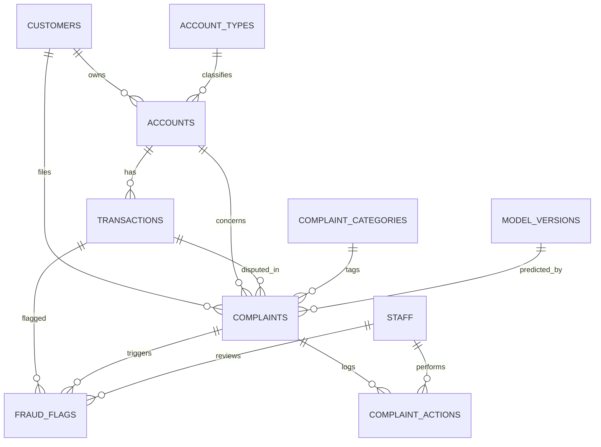

# PLAN.md: Fraud-Aware Transaction Complaint Analyzer

> Instructions for the coding agent: execute the phases below IN ORDER. After each phase run its
> "Acceptance check", fix failures, then `git commit -m "phase N: <name>"`. Do not start the next
> phase until the check passes. Ask the human only if blocked (e.g. dataset download fails).

## 0. Project summary

A banking web app (Flask + SQLite) where customers file free-text complaints about their
transactions. An NLP pipeline classifies each complaint (category, sentiment, urgency), and the
system raises fraud flags by combining NLP output with rule-based checks on transaction data. Staff
review complaints and flags through a dashboard.

Satisfies both subjects:
- **DBMS:** normalized (3NF) schema, constraints, indexes, views, triggers, CRUD GUI, SQL reports.
- **AI/NLP:** text cleaning, TF-IDF + Logistic Regression classifier, sentiment analysis,
  urgency scoring, evaluation metrics (accuracy, macro-F1, confusion matrix).

## 1. Tech stack (fixed, do not substitute)

| Layer | Choice |
|---|---|
| Language | Python 3.11+ |
| Web/GUI | Flask + Jinja2 templates + Bootstrap 5 (CDN) + Chart.js (CDN) |
| Database | SQLite via the built-in `sqlite3` module, **raw SQL** (no ORM, so SQL is visible for evaluation). Keep DDL MySQL-portable where possible. |
| NLP/ML | pandas, scikit-learn, nltk (VADER), joblib |
| Testing | pytest |
| Diagrams | Mermaid (`.mmd`), exported to PNG with `npx @mermaid-js/mermaid-cli` if available |

`requirements.txt`: flask, pandas, scikit-learn, nltk, joblib, pytest, matplotlib, werkzeug, faker

## 2. Repository layout

```
complaint-analyzer/
├── app/
│   ├── __init__.py          # Flask app factory, registers blueprints
│   ├── db.py                # get_db(), init_db(), query helpers
│   ├── auth.py              # login/logout, role_required decorator
│   ├── routes/
│   │   ├── customers.py  accounts.py  transactions.py
│   │   ├── complaints.py fraud.py     reports.py   model_info.py
│   ├── services/
│   │   ├── nlp_service.py   # load model, predict(text) -> dict
│   │   └── fraud_rules.py   # rule-based transaction checks
│   ├── templates/           # base.html + one folder per module
│   └── static/
├── sql/
│   ├── schema.sql  triggers.sql  views.sql  indexes.sql  queries.sql
├── ml/
│   ├── prepare_data.py      # clean + map CFPB data -> data/processed.csv
│   ├── train.py             # train, evaluate, save model + metrics
│   └── models/              # complaint_clf.joblib (git-ignored if large)
├── data/                    # raw/ (CFPB csv), processed.csv, seed outputs
├── scripts/seed_db.py       # fake customers/accounts/transactions + sample complaints
├── tests/                   # test_db.py test_nlp.py test_rules.py test_routes.py
├── docs/                    # SRS.md erd.mmd normalization.md TEST_REPORT.md PROGRESS.md
├── config.py  run.py  requirements.txt  README.md
```

## 3. Database design

### 3.1 Tables (create in `sql/schema.sql`; enable `PRAGMA foreign_keys = ON` on every connection)

```sql
CREATE TABLE account_types (
  type_id INTEGER PRIMARY KEY AUTOINCREMENT,
  type_name TEXT NOT NULL UNIQUE            -- Savings, Current, Credit Card, Loan
);
CREATE TABLE customers (
  customer_id INTEGER PRIMARY KEY AUTOINCREMENT,
  full_name TEXT NOT NULL,
  email TEXT NOT NULL UNIQUE CHECK (email LIKE '%_@_%._%'),
  phone TEXT,
  city TEXT,
  created_at TEXT NOT NULL DEFAULT (datetime('now'))
);
CREATE TABLE accounts (
  account_id INTEGER PRIMARY KEY AUTOINCREMENT,
  customer_id INTEGER NOT NULL REFERENCES customers(customer_id) ON DELETE CASCADE,
  type_id INTEGER NOT NULL REFERENCES account_types(type_id),
  account_number TEXT NOT NULL UNIQUE,
  balance REAL NOT NULL DEFAULT 0,
  status TEXT NOT NULL DEFAULT 'ACTIVE' CHECK (status IN ('ACTIVE','FROZEN','CLOSED')),
  opened_on TEXT NOT NULL DEFAULT (date('now'))
);
CREATE TABLE transactions (
  txn_id INTEGER PRIMARY KEY AUTOINCREMENT,
  account_id INTEGER NOT NULL REFERENCES accounts(account_id) ON DELETE CASCADE,
  txn_type TEXT NOT NULL CHECK (txn_type IN ('CREDIT','DEBIT')),
  amount REAL NOT NULL CHECK (amount > 0),
  merchant TEXT,
  location TEXT,                             -- city/country string
  txn_time TEXT NOT NULL DEFAULT (datetime('now')),
  status TEXT NOT NULL DEFAULT 'COMPLETED' CHECK (status IN ('COMPLETED','DISPUTED','REVERSED'))
);
CREATE TABLE complaint_categories (
  category_id INTEGER PRIMARY KEY AUTOINCREMENT,
  name TEXT NOT NULL UNIQUE                  -- see 4.2 for the 5 fixed values
);
CREATE TABLE model_versions (
  model_id INTEGER PRIMARY KEY AUTOINCREMENT,
  name TEXT NOT NULL,
  accuracy REAL, macro_f1 REAL,
  trained_at TEXT NOT NULL DEFAULT (datetime('now'))
);
CREATE TABLE staff (
  staff_id INTEGER PRIMARY KEY AUTOINCREMENT,
  username TEXT NOT NULL UNIQUE,
  password_hash TEXT NOT NULL,
  role TEXT NOT NULL CHECK (role IN ('ADMIN','AGENT'))
);
CREATE TABLE complaints (
  complaint_id INTEGER PRIMARY KEY AUTOINCREMENT,
  customer_id INTEGER NOT NULL REFERENCES customers(customer_id) ON DELETE CASCADE,
  account_id INTEGER REFERENCES accounts(account_id),
  txn_id INTEGER REFERENCES transactions(txn_id),
  complaint_text TEXT NOT NULL CHECK (length(complaint_text) >= 20),
  submitted_at TEXT NOT NULL DEFAULT (datetime('now')),
  status TEXT NOT NULL DEFAULT 'OPEN' CHECK (status IN ('OPEN','IN_REVIEW','RESOLVED','REJECTED')),
  category_id INTEGER REFERENCES complaint_categories(category_id),   -- predicted/overridden
  confidence REAL,
  sentiment_score REAL,                      -- VADER compound, -1..1
  sentiment_label TEXT CHECK (sentiment_label IN ('NEGATIVE','NEUTRAL','POSITIVE')),
  urgency TEXT CHECK (urgency IN ('LOW','MEDIUM','HIGH')),
  model_id INTEGER REFERENCES model_versions(model_id),
  resolved_at TEXT
);
CREATE TABLE fraud_flags (
  flag_id INTEGER PRIMARY KEY AUTOINCREMENT,
  txn_id INTEGER NOT NULL REFERENCES transactions(txn_id) ON DELETE CASCADE,
  complaint_id INTEGER REFERENCES complaints(complaint_id) ON DELETE SET NULL,
  source TEXT NOT NULL CHECK (source IN ('RULE','NLP','MANUAL')),
  reason TEXT NOT NULL,
  severity TEXT NOT NULL CHECK (severity IN ('LOW','MEDIUM','HIGH')),
  status TEXT NOT NULL DEFAULT 'PENDING' CHECK (status IN ('PENDING','CONFIRMED','DISMISSED')),
  reviewed_by INTEGER REFERENCES staff(staff_id),
  created_at TEXT NOT NULL DEFAULT (datetime('now'))
);
CREATE TABLE complaint_actions (            -- audit trail
  action_id INTEGER PRIMARY KEY AUTOINCREMENT,
  complaint_id INTEGER NOT NULL REFERENCES complaints(complaint_id) ON DELETE CASCADE,
  staff_id INTEGER REFERENCES staff(staff_id),
  action TEXT NOT NULL,                     -- e.g. STATUS_CHANGED, CATEGORY_OVERRIDDEN, NOTE
  note TEXT,
  acted_at TEXT NOT NULL DEFAULT (datetime('now'))
);
```

### 3.2 Indexes (`sql/indexes.sql`)
`transactions(account_id, txn_time)`, `complaints(customer_id)`, `complaints(status, urgency)`,
`complaints(category_id)`, `fraud_flags(status)`, `accounts(customer_id)`.

### 3.3 Triggers (`sql/triggers.sql`)
1. `trg_txn_update_balance` AFTER INSERT ON transactions: add amount for CREDIT, subtract for DEBIT.
2. `trg_complaint_fraud_flag` AFTER INSERT ON complaints WHEN `NEW.txn_id IS NOT NULL` AND NEW
   category is "Fraud / Unauthorized Transaction": insert a `fraud_flags` row (source `NLP`,
   severity from `NEW.urgency`) and set that transaction's status to `DISPUTED`.
3. `trg_complaint_status_audit` AFTER UPDATE OF status ON complaints: insert into
   `complaint_actions`; if new status is `RESOLVED`, set `resolved_at`.

### 3.4 Views (`sql/views.sql`)
- `v_complaint_overview`: complaint + customer name + category name + account number + txn amount.
- `v_fraud_dashboard`: flags joined with transaction, customer and complaint.
- `v_category_stats`: complaint count, avg sentiment, % HIGH urgency per category.
- `v_monthly_complaints`: complaints per month per category.

### 3.5 Report queries (`sql/queries.sql`, each wired to the Reports page)
Top 10 customers by complaint count; avg resolution time per category; accounts with 3+ fraud
flags (GROUP BY/HAVING); transactions flagged by both RULE and NLP (INTERSECT or self-join);
customers with no complaints (LEFT JOIN / NOT EXISTS); complaints above average negative sentiment
(subquery).

### 3.6 Normalization document (`docs/normalization.md`)
Show a deliberately un-normalized flat table (customer, account, account type, transaction,
complaint, category in one row), then walk through 1NF (atomic values, key), 2NF (remove partial
dependencies: split customers/accounts/transactions), 3NF (remove transitive dependencies:
account_types, complaint_categories, model_versions). List functional dependencies for each final
table and state that all tables are in 3NF (and BCNF where it applies).

### 3.7 ER diagram (`docs/erd.mmd`)

Also export a PNG to `docs/erd.png`, and add the attributes to each entity before exporting.

## 4. NLP / ML pipeline

### 4.1 Data
- Dataset: CFPB Consumer Complaint Database (consumerfinance.gov, "Consumer Complaint Database"
  CSV export). The human downloads it to `data/raw/complaints.csv`. If it is missing, **stop and
  ask the human**; as a fallback only, generate a small synthetic dataset so the pipeline can be
  tested, and clearly mark it synthetic.
- Inspect the actual column names first (they vary by export year). Keep rows where the
  narrative column is non-empty.
- Sample at most ~3,000 rows per category for balance and fast training.

### 4.2 Fixed label set (5 categories, seeded into `complaint_categories`)
1. `Fraud / Unauthorized Transaction`
2. `Credit Card Issue`
3. `Loan / Mortgage Issue`
4. `Bank Account / Service Issue`
5. `Credit Reporting / Other`

Mapping (`ml/prepare_data.py`): use the CFPB `Product` column for categories 2-5, then override to
category 1 when `Issue`/`Sub-issue` or the narrative matches
`fraud|unauthorized|scam|stolen|identity theft|did not authorize|not my transaction`.
Print the final class counts and save `data/processed.csv` with columns `text,label`.

### 4.3 Preprocessing
Lowercase, remove masked tokens (`XXXX`, `{$...}`), strip digits and punctuation, collapse
whitespace. Keep it in one function `clean_text()` shared by training and inference.

### 4.4 Model (`ml/train.py`)
- `TfidfVectorizer(ngram_range=(1,2), min_df=5, max_df=0.9, stop_words='english')`
- `LogisticRegression(max_iter=1000, class_weight='balanced')` in a single sklearn `Pipeline`
- Stratified 80/20 split, `random_state=42`
- Save: `ml/models/complaint_clf.joblib`, `ml/models/metrics.json` (accuracy, macro-F1, per-class
  precision/recall/F1), `docs/confusion_matrix.png`, and the top 10 TF-IDF terms per class
  (`docs/top_terms.md`)
- Insert a row into `model_versions` with accuracy and macro-F1.
- Target: macro-F1 >= 0.70. Report the real number honestly even if it is lower.

### 4.5 Sentiment and urgency (`app/services/nlp_service.py`)
- Sentiment: NLTK VADER compound score; label NEGATIVE <= -0.05, POSITIVE >= 0.05, else NEUTRAL.
  Download `vader_lexicon` at setup.
- Urgency (heuristic, document it as such in the SRS): start at score 0.
  +2 if category is Fraud; +1 if sentiment <= -0.5; +1 if text contains
  `immediately|urgent|stolen|drained|lost all|cannot access|emergency`; +1 if a linked transaction
  amount is above 10,000. Score >= 3 is HIGH, 2 is MEDIUM, otherwise LOW.
- `predict(text, txn_amount=None)` returns
  `{category, confidence, sentiment_score, sentiment_label, urgency, model_id}`.
- If confidence < 0.45, store the category but mark the complaint `IN_REVIEW` for manual
  categorisation.

## 5. Rule-based fraud checks (`app/services/fraud_rules.py`)

Run on every new transaction (called from the transactions route after insert) and write to
`fraud_flags` with source `RULE`:
1. **Amount spike:** amount > 5x the account's average DEBIT amount (needs >= 5 prior txns). HIGH.
2. **Velocity:** 4 or more DEBIT transactions on one account within 10 minutes. MEDIUM.
3. **Location change:** location differs from the account's most common location in the last 30
   days. MEDIUM.
Avoid duplicate flags (same txn + same reason).

## 6. Application (Flask)

### 6.1 Auth and roles
Staff login with hashed passwords (`werkzeug.security`). ADMIN: everything including staff,
customers and model info. AGENT: complaints, fraud flags, reports (read-only on customers).
Customer-facing "Submit complaint" page needs no login but looks the customer up by email +
account number.

### 6.2 Pages and routes
| Page | Route | Notes |
|---|---|---|
| Login / logout | `/login` `/logout` | |
| Dashboard | `/` | KPI cards (open complaints, high urgency, pending flags), Chart.js: complaints by category, monthly trend, sentiment split |
| Customers CRUD | `/customers` | list, search, add, edit, delete with confirm |
| Accounts CRUD | `/accounts` | filter by customer; shows balance |
| Transactions | `/transactions` | list + add (runs fraud rules); filter by account/date/status |
| Submit complaint | `/complaint/new` | free text + optional transaction picker; shows predicted category and urgency on success |
| Complaints | `/complaints` | filters: status, category, urgency, sentiment; sortable |
| Complaint detail | `/complaints/<id>` | override category, change status, add note, audit trail, linked transaction and flags |
| Fraud flags | `/fraud` | review queue: confirm / dismiss |
| Reports | `/reports` | the queries in 3.5 as tables, with CSV export |
| Model info | `/model` | latest metrics, confusion matrix image, "try it" box that classifies pasted text without saving |

### 6.3 Quality rules
- All SQL uses parameterised queries (no string formatting) to prevent SQL injection.
- Server-side validation plus friendly flash messages; Jinja autoescape stays on.
- Consistent Bootstrap layout via `base.html`, with responsive tables and flash alerts.
- Load the model once at app start, not per request.

## 7. Seed data (`scripts/seed_db.py`)
Idempotent script (drops and recreates the DB when run with `--reset`):
- 5 account types, 5 categories, 1 ADMIN (`admin` / `admin123`), 1 AGENT (`agent` / `agent123`);
  print a note that these are demo credentials only.
- 200 customers, ~300 accounts, ~5,000 transactions across 6 months (Faker, fixed seed), including
  some injected anomalies (spikes, bursts, foreign locations).
- 150 sample complaints sampled from the processed CFPB data and linked to random customers and
  transactions, each run through `nlp_service.predict`.

## 8. Testing (`tests/`, run with `pytest -v`)
- `test_db.py`: constraint violations (bad email, negative amount, invalid status, FK failure),
  cascade delete, each trigger fires correctly, each view returns rows.
- `test_nlp.py`: `clean_text` cases, predict returns required keys, obvious fraud sentence maps to
  category 1, VADER label thresholds, urgency heuristic cases.
- `test_rules.py`: each fraud rule triggers and does not trigger on crafted data; no duplicate flags.
- `test_routes.py`: Flask test client: login required, role restrictions, create/edit/delete
  customer, submit complaint end to end, SQL-injection string is handled safely.
- Generate `docs/TEST_REPORT.md` containing: test environment, a table of test cases (ID,
  description, input, expected, actual, pass/fail), pytest summary, ML metrics table, known
  limitations.

## 9. Documentation deliverables (`docs/`)
- `SRS.md` (IEEE-style): purpose, scope, users, functional requirements (numbered FR-1...),
  non-functional requirements, constraints, use cases (submit complaint, review flag, override
  category), assumptions, ER diagram reference.
- `normalization.md`, `erd.mmd` and `erd.png` (section 3).
- `TEST_REPORT.md` (section 8).
- `PROGRESS.md`: weekly log table (week, planned, done, owner, blockers); pre-fill the plan below.
- `README.md`: setup (`python -m venv`, `pip install -r requirements.txt`, download dataset, run
  `python ml/prepare_data.py && python ml/train.py && python scripts/seed_db.py --reset &&
  python run.py`), screenshots placeholder, team roles.

## 10. Phases (agent execution order)

| # | Phase | Output | Acceptance check |
|---|---|---|---|
| 1 | Scaffold | repo layout, venv notes, requirements, config, app factory, `/` hello page | `python run.py` serves the page |
| 2 | Database | all `sql/*.sql`, `db.py`, `init_db` | `init_db` runs clean; `test_db.py` passes |
| 3 | Data + ML | prepare_data, train, metrics, model_versions row | `metrics.json` exists; macro-F1 printed |
| 4 | NLP service | `nlp_service.py`, `fraud_rules.py` | `test_nlp.py`, `test_rules.py` pass |
| 5 | Seed | `seed_db.py` | counts in 7 match; views return data |
| 6 | Auth + CRUD GUI | customers, accounts, transactions pages | manual walkthrough + route tests pass |
| 7 | Complaint workflow | submit, list, detail, fraud queue | end-to-end test: submit a fraud complaint, see a flag created by the trigger |
| 8 | Dashboard + reports + model page | charts, queries, CSV export | all report queries render without error |
| 9 | Testing + docs | TEST_REPORT, SRS, normalization, ERD PNG | `pytest` all green; docs complete |
| 10 | Polish | error pages (404/500), UI cleanup, README, final demo script | fresh clone to running app using README only |

## 11. Suggested 5-week schedule (for PROGRESS.md)
Week 1: SRS draft, ER diagram, schema, normalization. Week 2: DB, seed, dataset prep, baseline
model. Week 3: CRUD GUI, NLP service, fraud rules. Week 4: complaint workflow, dashboard, reports.
Week 5: testing, report, demo rehearsal.

## 12. Definition of done
- A fresh clone runs by following README only.
- `pytest` passes; the TEST_REPORT shows real results.
- All 6 deliverables exist: SRS, ER diagram, normalized schema doc, GUI, source code, test report.
- Demo path works: log in, add a transaction (rule flag appears), submit a fraud complaint
  (classified, urgency set, trigger flag appears), review the flag, view the dashboard.
- No secrets committed; demo credentials are documented as demo-only.
